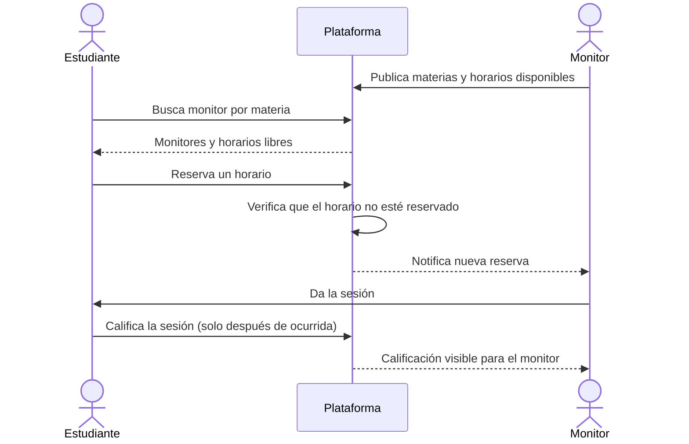

# Plataforma de Monitorías entre Estudiantes

Plataforma donde los estudiantes que dominan una materia (**monitores**) publican sus horarios y otros estudiantes **reservan sesiones** de apoyo. Un **coordinador** administra las materias y los monitores, y puede ver cómo va el servicio.

> Proyecto de la **Academia de Diseño de Software** — Departamento de Software, Universidad del Magdalena · SYSTE+.
> Basado en el *Documento maestro del proyecto* (20 de octubre de 2026). En clase lo completamos juntos: levantamos requisitos y los convertimos en diagramas, datos, contratos y código.

---

## Tabla de contenido

- [Problema](#problema)
- [Objetivos](#objetivos)
- [Actores](#actores)
- [Funcionalidades iniciales](#funcionalidades-iniciales)
- [Reglas de negocio](#reglas-de-negocio)
- [Por definir con los estudiantes](#por-definir-con-los-estudiantes)
- [Flujo principal](#flujo-principal)
- [Hoja de ruta](#hoja-de-ruta)
- [Estructura del repositorio](#estructura-del-repositorio)
- [Cómo contribuir](#cómo-contribuir)

---

## Problema

Hoy, conseguir ayuda en una materia depende de **conocer a alguien**. No hay una forma ordenada de ver quién ayuda, en qué horario y cómo le fue a quien ya recibió la ayuda.

## Objetivos

### General

Que un estudiante pueda **encontrar un monitor** de su materia, **reservar una sesión** y **calificarla** después, y que el coordinador pueda **ver cómo va todo**.

### Específicos

- Mostrar qué monitores hay por materia y cuándo están disponibles.
- Permitir reservar y cancelar sesiones **sin choques de horario**.
- Recoger la calificación de cada sesión.
- Darle al coordinador una vista clara del servicio.

## Actores

| Actor | Qué necesita hacer |
|---|---|
| **Estudiante** | Buscar un monitor por materia. Ver sus horarios. Reservar y cancelar una sesión. Calificar la sesión después de que ocurre. |
| **Monitor** | Publicar las materias que domina y sus horarios disponibles. Ver las reservas que tiene. Dar la sesión y ver sus calificaciones. |
| **Coordinador** | Administrar materias y monitores. Consultar reportes de sesiones y calificaciones. |

## Funcionalidades iniciales

| Módulo | Qué debe permitir |
|---|---|
| **Cuentas y acceso** | Registro e ingreso de estudiantes, monitores y coordinador, cada uno con sus permisos. |
| **Materias y monitores** | Catálogo de materias y de los monitores que las dominan. |
| **Disponibilidad** | El monitor publica y administra sus horarios. |
| **Reservas** | El estudiante reserva y cancela una sesión en un horario libre. |
| **Asignación de monitor** | El sistema propone un monitor por materia, por disponibilidad o por calificación. |
| **Calificaciones** | El estudiante califica la sesión una vez terminada. |
| **Reportes** | El coordinador consulta sesiones, uso y calificaciones. |

## Reglas de negocio

1. **Un horario no se puede reservar dos veces.**
2. **Solo se califica una sesión después de que ocurrió.**
3. **Nadie puede editar las sesiones de otra persona.**
4. **Solo el coordinador gestiona materias y monitores.**

## Por definir con los estudiantes

Estas preguntas se resuelven en clase durante el levantamiento de requisitos. A medida que se decidan, se documentarán aquí.

| # | Pregunta | Decisión |
|---|---|---|
| 1 | ¿Cuánto dura una sesión y se puede reservar más de una a la vez? | _Pendiente_ |
| 2 | ¿Hasta cuándo antes de la sesión se puede cancelar? | _Pendiente_ |
| 3 | ¿Un monitor puede cubrir varias materias? | _Pendiente_ |
| 4 | ¿Quién aprueba que alguien sea monitor? | _Pendiente_ |
| 5 | ¿La calificación es solo un número o lleva comentario? | _Pendiente_ |
| 6 | ¿Las sesiones son individuales o también grupales? | _Pendiente_ |
| 7 | ¿Qué pasa si el monitor no se presenta? | _Pendiente_ |

## Flujo principal



## Hoja de ruta

El proyecto avanza junto con la academia:

- [ ] Levantamiento y cierre de requisitos (resolver las preguntas abiertas)
- [ ] Casos de uso e historias de usuario
- [ ] Diagramas (casos de uso, clases, secuencia, entidad-relación)
- [ ] Modelo de datos
- [ ] Contratos de la API
- [ ] Implementación por módulos
- [ ] Pruebas
- [ ] Despliegue

## Estructura del repositorio

> La estructura se irá definiendo a medida que avance el proyecto. Propuesta inicial:

```
plataforma-monitorias/
├── docs/          # Requisitos, diagramas, modelo de datos y contratos
└── README.md
```

## Cómo contribuir

1. Crea una rama a partir de `main`: `git checkout -b feature/nombre-de-la-funcionalidad`
2. Haz commits pequeños y descriptivos.
3. Abre un Pull Request describiendo el cambio y el requisito o regla de negocio que atiende.
